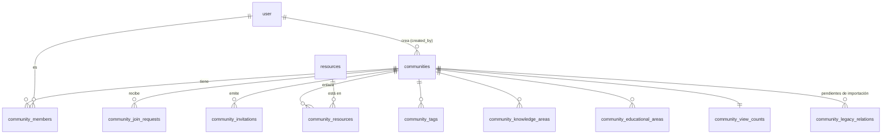
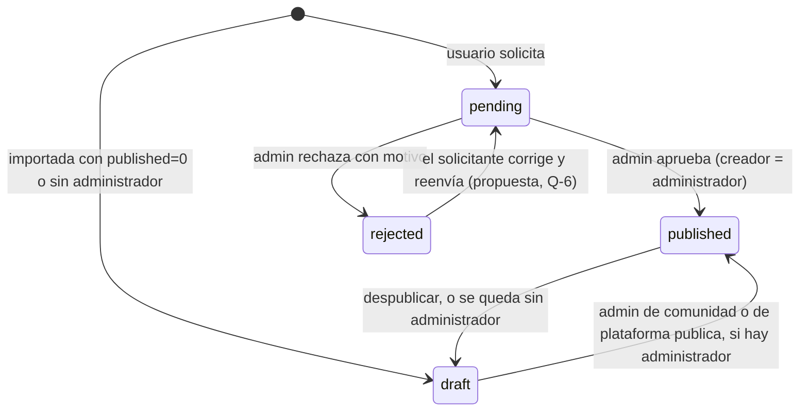

# Design — Épica 006: comunidades

## Estado
Propuesta (2026-11-16). Modelo en [ADR-0050](../../negocio/decisiones/0050-modelo-de-comunidades.md). No hay código todavía; los nombres de tablas y rutas son propuestos y se fijan al implementar.

## Resumen
Una comunidad es una entidad propia con metadatos descriptivos, una modalidad (pública o privada), un estado y una lista de miembros con rol de comunidad. Enlaza recursos ya existentes, entre ellos los artículos, que en esta plataforma son recursos de tipo «Artículo» (#517). Reutiliza las taxonomías, las etiquetas y el contador de visitas de los recursos, y no toca los roles globales.

## Qué se reutiliza
| Necesidad | Pieza existente | Cómo |
|---|---|---|
| Etiquetas | `tags` (ADR-0034, ADR-0042) | Tabla de unión `community_tags` |
| Áreas de conocimiento | `knowledge_areas` (ADR-0045) | Tabla de unión `community_knowledge_areas`, máximo 3 como en recursos |
| Contexto educativo | Categorización de dos niveles (ADR-0043, `resource_educational_areas`) | Tabla `community_educational_areas` con la misma forma |
| Visitas | ADR-0044 (`resource_view_counts`, `resource_view_sessions`) | `community_view_counts` y `community_view_sessions` con el mismo mecanismo y `legacy_view_count` |
| Recursos y artículos | `resources` (los artículos son `resource_type = articulo`) | Tabla de unión `community_resources` |
| Imagen | Portada de colecciones (`collections.cover_image_url`) y subidas existentes | `cover_image_url` y la misma validación de imágenes |
| Idempotencia de importación | Patrón `import_source` + `external_id` de `resources` y `collections` (#573) | Mismas columnas e índice único parcial |
| Cuentas importadas | `legacy-procomun:user:<uid>` (#488) y búsqueda por correo (#508) | Resolución de miembros y administradores |
| Autorización | RBAC de Better Auth (ADR-0008) | Rol global solo para `admin`; el resto, por pertenencia |

No se reutiliza `collections` como base: ver ADR-0050, opción B.

## Modelo de datos

### `communities`
| Columna | Tipo | Notas |
|---|---|---|
| `id` | text PK | |
| `slug` | varchar(512) único | Alias de URL; del título si no se indica |
| `title` | text not null | Metadato «Título» |
| `description` | text not null | Metadato «Texto». Texto plano con párrafos; el HTML legacy se limpia |
| `cover_image_url` | text | Metadato «Imagen» |
| `visibility` | varchar `public` \| `private` | Modalidad. Check constraint |
| `status` | varchar `pending` \| `rejected` \| `draft` \| `published` | Estado. Check constraint |
| `created_by` | text FK `user.id` `on delete set null` | Metadato «Usuario» (creador). Nulo si la cuenta no existe o se borra |
| `created_at` | timestamp | Metadato «Fecha». En importadas, `metadata.communityDate` si existe |
| `published_at` | timestamp | Primera publicación (`metadata.publicationDate` en importadas) |
| `reviewed_by`, `reviewed_at`, `rejection_reason` | | Decisión del `admin` sobre la solicitud |
| `import_source`, `external_id` | text | `legacy-procomun` + ID Drupal. Índice único parcial como en `resources` |
| `legacy_search_id` | text | `idElasticSearch` |
| `legacy_urls` | text[] | `urlDrupal`, para redirecciones futuras |
| `search_vector` | tsvector | Título (A), etiquetas (A), descripción (B), config `es_unaccent` |
| `updated_at`, `deleted_at` | timestamp | Borrado lógico como en recursos |

Campos técnicos adicionales a los nueve de #493, y por qué: `slug` (URL amigable, pedido en el formulario legacy), `visibility` y `status` (modalidad y flujo de aprobación), `reviewed_*` y `rejection_reason` (trazabilidad de la decisión), `published_at`, `import_source`, `external_id`, `legacy_search_id` y `legacy_urls` (trazabilidad de #495), `search_vector` (búsqueda del listado) y `deleted_at`.

### `community_members`
| Columna | Notas |
|---|---|
| `community_id` FK `on delete cascade` | |
| `user_id` FK `user.id` `on delete cascade` | Borrar la cuenta borra la membresía (#504) |
| `role` | `admin` \| `member` |
| `joined_at` | |
| `added_by` | Quién aceptó, invitó o importó (nulo si se unió solo a una pública) |
PK (`community_id`, `user_id`); índice por `user_id` para «Mis comunidades».

### `community_join_requests`
`id`, `community_id`, `user_id`, `status` (`pending` \| `accepted` \| `rejected` \| `cancelled`), `message` (opcional, corto), `decided_by`, `decided_at`, `created_at`. Índice único parcial (`community_id`, `user_id`) `where status = 'pending'`.

### `community_invitations`
`id`, `community_id`, `email` (normalizado) o `user_id`, `role` (`member` por defecto; ver Q-4), `token_hash` (SHA-256; el token en claro solo va en el enlace), `status` (`pending` \| `accepted` \| `declined` \| `revoked` \| `expired`), `invited_by`, `expires_at`, `created_at`, `decided_at`. Al aceptarse, caducar o revocarse se borra el correo (minimización).

### `community_resources`
`community_id`, `resource_id` FK `on delete cascade`, `added_by`, `added_at`. PK compuesta. No guarda orden: el contenido se lista por fecha o relevancia (las comunidades no son secuencias, a diferencia de los itinerarios).

### Taxonomías y visitas
- `community_tags` (`community_id`, `tag_id`).
- `community_knowledge_areas` (`community_id`, `area_id`), máximo 3 en la aplicación.
- `community_educational_areas` (`community_id`, `category_id`, `option_id`), con los mismos índices únicos parciales que `resource_educational_areas`.
- `community_view_counts` (`community_id` PK, `view_count`, `legacy_view_count`) y `community_view_sessions` (`community_id`, `session_hash`), purgadas como las de recursos.

### `community_legacy_relations`
Relaciones del JSON que el importador no pudo resolver: `community_id`, `kind` (`member` \| `admin` \| `ode` \| `post`), `legacy_id`, `reason`, `last_attempt_at`. Permite reintentar sin el JSON y que la administración vea qué falta. No guarda correos.

### Invariantes en base de datos
- Check de `visibility` y `status`.
- Unicidad de miembro, de solicitud pendiente, de enlace y de `(import_source, external_id)`.
- «Publicada ⇒ al menos un administrador»: lo garantiza el servicio dentro de una transacción con bloqueo de la fila de la comunidad (alta, baja y cambio de rol de miembros, cambio de estado). Se valora además un trigger de restricción diferido; ver «Riesgos».

## Estados

- `pending` y `rejected` solo los ve el solicitante y los `admin`.
- `draft` solo lo ven sus administradores y los `admin`. Una comunidad en `draft` sin administrador solo la ven los `admin`, en una lista «Sin administrador».
- Una comunidad pasa sola de `published` a `draft` si se queda sin administrador por una causa ajena (cuenta borrada). Las acciones de usuario que la dejarían sin administrador se rechazan (RF-017, RF-018).
- Al asignar un administrador a un borrador no se publica sola; la publica un administrador (propuesta, Q-7).
- Modalidad y estado son independientes: una privada puede estar publicada y una pública en borrador (casos 328 y 520 de #495).

## Permisos

Actores: anónimo, autenticado, miembro, administrador de comunidad (AC) y `admin` de la plataforma. Los roles globales `reader`, `author`, `editor` y `curator` no dan permisos sobre comunidades: cuenta la pertenencia (#493: no modificar los permisos globales).

| Acción | Anónimo | Autenticado | Miembro | AC | `admin` |
|---|:-:|:-:|:-:|:-:|:-:|
| Ver listado y descripción de publicadas | ✓ | ✓ | ✓ | ✓ | ✓ |
| Ver contenido de una pública | ✓ | ✓ | ✓ | ✓ | ✓ |
| Ver contenido de una privada | — | — | ✓ | ✓ | ✓ |
| Ver lista de miembros (propuesta, Q-3) | — | — | ✓ | ✓ | ✓ |
| Solicitar creación | — | ✓ | ✓ | ✓ | ✓ |
| Aprobar o rechazar creación | — | — | — | — | ✓ |
| Unirse a una pública | — | ✓ | | | |
| Solicitar ingreso a una privada | — | ✓ | | | |
| Aceptar o rechazar solicitudes de ingreso | — | — | — | ✓ | ✓ |
| Invitar | — | — | — (Q-4) | ✓ | ✓ |
| Nombrar o retirar AC, expulsar miembros | — | — | — | ✓ | ✓ |
| Editar metadatos | — | — | — | ✓ | ✓ |
| Enlazar recursos publicados | — | — | propios (Q-2) | cualquiera | cualquiera |
| Desenlazar recursos | — | — | los que enlazó (Q-2) | cualquiera | cualquiera |
| Publicar o despublicar | — | — | — | ✓ (Q-7) | ✓ |
| Borrar | — | — | — | — | ✓ |

Funciones de autorización propuestas, al estilo de `canViewResource` y `canManageCollection`: `canViewCommunity`, `canViewCommunityContent`, `canManageCommunity` (AC o `admin`) y `canReviewCommunityRequest` (`admin`). Para quien no puede ver una comunidad no publicada se responde 404, no 403, para no revelar que existe.

Una cuenta bloqueada no actúa en comunidades. Si un AC está bloqueado, sigue contando como administrador para la invariante (la cuenta existe); ver Q-8.

## Flujos principales

### Crear una comunidad
1. Un usuario autenticado rellena el formulario (título, descripción, imagen, etiquetas, áreas, contexto, modalidad, alias).
2. `POST` crea la comunidad en `pending` con `created_by` = el usuario. No crea membresía todavía.
3. Los `admin` la ven en la cola «Solicitudes de comunidad» del panel de administración.
4. Aprobar: en una transacción, `status = published`, `published_at`, `reviewed_*` y el creador como `admin` de la comunidad. Si el creador ya no existe, no se puede aprobar sin asignar otro administrador.
5. Rechazar: `status = rejected` con motivo obligatorio. El solicitante lo ve en «Mis comunidades».

Errores: alias repetido (409), metadatos inválidos (400), aprobar algo que no está en `pending` (409), quien no es `admin` (403).

### Unirse
- Pública: `POST …/membership` crea la membresía `member` al momento.
- Privada: el mismo `POST` crea una solicitud `pending` (409 si ya hay una). Los AC la ven en su panel; aceptar crea la membresía y cierra la solicitud en la misma transacción.

### Invitar
1. Un AC indica el correo de la persona invitada.
2. Se crea la invitación con token y caducidad (propuesta: 14 días).
3. La persona, con sesión iniciada con ese correo, la acepta o la rechaza desde el enlace o desde «Mis comunidades».
4. La respuesta de la API es la misma exista o no una cuenta con ese correo, para no permitir averiguar quién está registrado.

### Enlazar contenido
`PUT …/resources/:resourceId` comprueba que el recurso está publicado y que quien enlaza puede hacerlo (tabla de permisos). Un recurso despublicado sigue enlazado pero no se lista.

### Quedarse sin administrador
Borrar una cuenta borra sus membresías por cascada. Tras borrar una cuenta, el servicio de usuarios pasa a `draft` las comunidades publicadas que se han quedado sin administrador y lo registra en `activity_events`. Además, un comando de diagnóstico (`communities:check`, feature F1) lista cualquier comunidad publicada sin administrador.

## Contratos API (propuestos)

Públicos, en `/api/v1` (sesión opcional):
- `GET /communities?q=&tags=&admin=&from=&to=&visibility=&page=`: publicadas.
- `GET /communities/:slug`: descripción, recuentos, administradores y, si `canViewCommunityContent`, indicador de acceso al contenido.
- `GET /communities/:slug/resources?q=&type=&page=`: contenido publicado. 404 si no se puede ver; 403 en privada para quien no es miembro.
- `GET /communities/:slug/members`: solo miembros, AC y `admin`.
- `POST /communities/:slug/views`: visita (ADR-0044).

Con sesión, en `/api/admin` (patrón actual de gestión):
- `POST /communities` · `GET /communities?scope=mine|pending|all` · `PATCH /communities/:id`.
- `POST /communities/:id/approve` · `POST /communities/:id/reject`.
- `PATCH /communities/:id/status` (`draft` ↔ `published`).
- `POST /communities/:id/membership` (unirse o solicitar) · `DELETE /communities/:id/membership` (abandonar).
- `GET /communities/:id/requests` · `POST /communities/:id/requests/:rid/accept|reject`.
- `POST /communities/:id/invitations` · `DELETE /communities/:id/invitations/:iid` · `POST /community-invitations/:token/accept|decline`.
- `PATCH /communities/:id/members/:userId` (rol) · `DELETE /communities/:id/members/:userId`.
- `PUT|DELETE /communities/:id/resources/:resourceId`.
- `PUT /communities/:id/admins` (solo `admin`: asignar administrador a una sin él).

Todas las respuestas usan los códigos y el formato de error actuales de la API.

## Navegación e interfaz
- Enlace «Comunidades» en `PublicLayout` (navegación superior y pie), después de «Colecciones», con el mismo estado activo por ruta.
- Rutas: `/comunidades` (listado con buscador y filtros), `/comunidades/:slug` (ficha), `/comunidades/nueva` (solicitud), `/comunidades/:slug/gestionar` (panel del AC: metadatos, solicitudes, invitaciones, miembros y contenido).
- «Mis comunidades» en el perfil: a las que pertenezco, mis solicitudes de creación e ingreso y mis invitaciones.
- Panel de administración: cola de solicitudes de creación y lista «Sin administrador».
- En la ficha del recurso, «Está en las comunidades…» con las públicas publicadas (propuesta, Q-1).
- Componentes del design system actual (tarjetas, pills, paginación, formularios de colecciones), textos en Paraglide (es, en, ca, gl, eu), WCAG 2.1 AA: estados anunciados con `aria-live`, botones con nombre accesible, foco tras cada acción, sin color como único indicador de modalidad o estado.

## Importador (#495)

Comando `import:legacy-communities --source-file <comunidades.json> [--dry-run] [--limit <n>] [--only <id>] [--report-dir <ruta>]`, con el patrón de `import:legacy-users` y `import:legacy-itineraries` (#573). Se ejecuta a mano (D6). Orden previo: usuarios (#488), recursos ODE y artículos (#517).

| JSON | Destino |
|---|---|
| `id` | `external_id` (con `import_source = legacy-procomun`) |
| `label` (o `metadata.titleStr`) | `title` |
| `description` | `description` en texto plano, misma limpieza que #573 |
| `type` | `visibility`: `community` → `public`, `community_private` → `private` |
| `published` (nivel superior) | `published` si hay administrador; si no, `draft`. `0` → `draft`. Se ignora `metadata.published` |
| `idElasticSearch` | `legacy_search_id` |
| `urlDrupal` | `legacy_urls` |
| `metadata.communityDate` | `created_at` |
| `metadata.publicationDate` | `published_at` |
| `metadata.labelsStr` | etiquetas, con la normalización del catálogo (ADR-0042) |
| `admins` | miembros con rol `admin` |
| `miembros` | miembros con rol `member` (un administrador que también figure como miembro queda como `admin`) |
| `odes`, `posts` | `community_resources` |
| `metadata.certified`, `metadata.communityAdminSupsStr`, resto | Sin destino por ahora; se cuentan en el informe (Q-9, Q-10) |

Reglas:
- `-` o cadena vacía = sin relaciones. Las listas se separan por comas y se recortan.
- Usuarios: primero por el correo que añadirá el exportador (D8), con la regla de #508; si no viene, por el ID `legacy-procomun:user:<uid>`. Las cuentas dadas de baja no cuentan.
- Recursos y artículos: el JSON los da por ID Drupal (`38341`, `19648`), pero los recursos importados se identifican por `idODE` y los artículos por su ID de Elasticsearch. Hace falta una correspondencia (Q-11).
- Lo que no se resuelve se guarda en `community_legacy_relations` y sale en el informe. Reimportar reintenta lo pendiente.
- Una comunidad falla sola (registro inválido o error de base de datos) sin parar el lote; cada comunidad va en su propia transacción.
- Idempotencia: por (`import_source`, `external_id`). Reimportar actualiza título, descripción y fechas, añade relaciones nuevas y no borra las añadidas a mano. No toca el alias, el estado cambiado a mano ni los administradores asignados a mano.
- Sin administrador resuelto: `draft`, `created_by` nulo y aviso `no_admin` en el informe. Se lista en «Sin administrador» del panel.
- Informe sin correos ni nombres (#543); los errores de base de datos pasan por `summarizeDbStepError`.

Resultado esperado con `Prueba_montar_comunidades.json` (depende de lo importado antes):

| ID | Modalidad | Estado esperado | Miembros | Admins | ODE | Artículos |
|---|---|---|---|---|---|---|
| 328 | privada | `published` | 1 (el admin 3848) | 1 | 3 | 0 |
| 520 | pública | `draft`, sin administrador | 0, 1 sin resolver | 0, 1 sin resolver | 0 | 0 |
| 607 | pública | `draft`, sin administrador (aunque `published` = 1) | 8, 17 sin resolver | 0, 1 sin resolver | 0 | 4, 1 sin resolver (19660) |
| 654 | pública | `published` | 2, 1 sin resolver (27287) | 1 | 0 | 0 |
| 829 | pública | `draft` con administrador | 1 | 1 | 0 | 0, 1 sin resolver (101331) |

## Búsqueda y descubrimiento
- Listado de comunidades con FTS propio (`search_vector`, `websearch_to_tsquery('es_unaccent', …)`), filtros por etiquetas, administrador, fecha y modalidad. Índice GIN parcial sobre las publicadas.
- Las comunidades no entran en la búsqueda general de recursos en esta épica (fuera de alcance). El buscador interno de la ficha filtra los recursos enlazados con el FTS de recursos ya existente.
- Pertenecer a una comunidad no cambia la posición de un recurso en el catálogo.
- Feeds y sitemap: solo comunidades publicadas, si se añaden (no es requisito).

## Moderación
- La creación pasa siempre por la aprobación de un `admin` (cola en el panel).
- Los AC moderan su comunidad: miembros, solicitudes y contenido enlazado.
- Los `admin` hacen de respaldo: asignan administradores, despublican y borran.
- Un recurso enlazado sigue su propio flujo editorial; si se retira, desaparece de la comunidad.
- El texto y la imagen de la comunidad no pasan por el flujo editorial de recursos; los revisa el `admin` al aprobar. Las ediciones posteriores del AC no se revisan (propuesta, Q-5).
- Auditoría: aprobaciones, rechazos, cambios de estado, altas y bajas de administradores y expulsiones van a `activity_events`.

## Datos personales (#504)
- Responsable: INTEF; tratamiento «Red social docente», base 6.1.e RGPD (respuesta en #504). Las comunidades entran en ese tratamiento.
- La membresía revela la afiliación de una persona a un grupo. Minimización propuesta (Q-3): el público ve el número de miembros y el nombre público de los administradores (necesario para saber a quién se pide el ingreso); la lista nominal solo la ven miembros, AC y `admin`. Nunca se publica el correo.
- Las invitaciones guardan el correo solo mientras están pendientes.
- Borrar la cuenta borra membresías, solicitudes e invitaciones (cascada); las comunidades que se queden sin administrador pasan a `draft`.
- El derecho de acceso y portabilidad de #504, si se implementa en la aplicación, debe incluir las comunidades del usuario y su rol.
- El informe del importador y `community_legacy_relations` no guardan correos ni nombres; solo IDs legacy.
- Los adjuntos de #495 con usuarios incluyen DNI, fecha de nacimiento y hash de contraseña: se usan solo en local y no se copian a fixtures del repositorio. Los tests usan datos sintéticos.

## Observabilidad
- Eventos de actividad listados arriba.
- Métricas: solicitudes de creación pendientes y su antigüedad, comunidades sin administrador, miembros y recursos por comunidad, visitas.
- Informe JSON del importador en `--report-dir`.

## Estrategia de pruebas
- Unitarias de permisos (`canViewCommunity`, `canViewCommunityContent`, `canManageCommunity`) con cada actor y cada combinación de modalidad y estado.
- Unitarias de la invariante del administrador: quitar, expulsar, abandonar y degradar al último AC; borrar su cuenta.
- Integración (PGlite) del flujo de creación y aprobación, de unirse, solicitar e invitar, y de las llamadas directas a la API que intentan saltarse la aprobación o ver contenido privado.
- Mapeo puro del importador y prueba de integración con un JSON sintético que reproduce los cinco casos de #495 (sin datos personales reales).
- Componentes de interfaz con Testing Library y comprobaciones de accesibilidad; e2e del flujo principal.

## Riesgos
- La invariante «publicada ⇒ administrador» repartida en el servicio puede romperse con una escritura directa; mitigación: comprobación periódica y, si hace falta, trigger diferido en PostgreSQL (verificar que PGlite lo soporta).
- La correspondencia de IDs Drupal de ODE y artículos no existe hoy en `resources` (Q-11). Sin ella el importador no asocia contenido.
- Volumen: comunidades con cientos de miembros o artículos (351 tiene 49 miembros y 107 artículos); paginar siempre.
- Spam de solicitudes de creación: limitar las pendientes por usuario (propuesta: 3).
- Dependencia de #504 para los textos legales y la exportación de datos.

## Preguntas abiertas (2026-11-16)
- Q-1: en una privada, ¿qué es contenido interno para quien no es miembro? Propuesta: la lista de recursos enlazados y la de miembros. ¿La ficha del recurso dice en qué comunidades privadas está?
- Q-2: ¿puede un miembro enlazar recursos? Propuesta: sus propios recursos publicados, y desenlazar los que él enlazó.
- Q-3: ¿quién ve la lista de miembros? Propuesta: solo miembros, AC y `admin`; el público ve el número y los administradores.
- Q-4: invitaciones: ¿solo los AC o también los miembros? ¿Por correo a cualquiera o solo a cuentas existentes? ¿Se puede invitar como administrador? ¿Caducidad?
- Q-5: moderación: ¿denuncias de comunidades? ¿Se revisan las ediciones posteriores de la descripción o la imagen?
- Q-6: ¿se puede corregir y reenviar una solicitud rechazada?
- Q-7: ¿puede el AC despublicar y volver a publicar su comunidad, o solo el `admin`? ¿Se publica sola al asignarle administrador si en el origen estaba publicada?
- Q-8: un AC con la cuenta bloqueada, ¿cuenta como administrador?
- Q-9: `metadata.certified`: ¿hay sello en comunidades?
- Q-10: `metadata.communityAdminSupsStr` trae 25 correos en la 607 (tantos como miembros) y un nombre de usuario en la 654: ¿qué es?
- Q-11: el exportador da los ODE y artículos por ID Drupal; ¿puede dar `idODE` y el ID de Elasticsearch, como los itinerarios de #573?
- Q-12: faltan en la exportación imagen, áreas de conocimiento, contexto educativo y visitas.
